<!-- markdownlint-disable MD033 MD041 -->
<div align="center">
  

  <h1>剪贴板酱 · Clipchan</h1>

  <p><b>一个只为 Windows 做的剪贴板历史工具。</b><br>
  按 <kbd>Ctrl</kbd>+<kbd>&#96;</kbd> 唤起面板，双击就粘回刚才那个窗口。</p>

  <p>
    
    
    
    
    
    
    
  </p>

  <p>
    <a href="https://github.com/jfxb666/clipchan/releases/latest"><b>下载安装版</b></a> ·
    <a href="#功能">功能</a> ·
    <a href="#截图">截图</a> ·
    <a href="docs/guide.md">使用手册</a> ·
    <a href="docs/privacy.md">隐私说明</a> ·
    <a href="docs/v1.0.0-升级实现说明.md">v1.0.0 实现说明</a>
  </p>
</div>

<p align="center">
  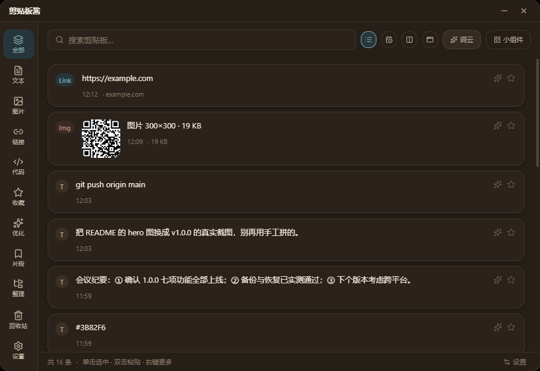
</p>

---

## 这是什么

每天要复制几十次东西：一段报错、一个链接、一张图、一串命令。系统自带的 <kbd>Win</kbd>+<kbd>V</kbd> 只留 25 条、不分类、不能搜中文拼音、图片一多就找不到。

Clipchan 是给「一天到晚在复制粘贴」的人做的：

- **快**：常驻托盘，<kbd>Ctrl</kbd>+<kbd>&#96;</kbd> 唤起，双击即粘贴回原窗口 —— 不用再切回浏览器找刚才那段话。
- **找得到**：搜原文、搜拼音全拼、搜首字母，还能写 `会议 OR 发布`、`after:2026-01-01`、`/\d{11}/` 这类条件。
- **能整理**：13 种本地规则自动打标签，三级文件夹分类，图片文本一视同仁。
- **不外传**：没有账号、没有服务器、没有遥测。所有数据就躺在 `%APPDATA%\Clipchan\` 里，删目录等于彻底清除。

> 单文件安装包 77 MB，装完占 291 MB（Electron 应用的体积下限就在这里），启动 0.3 秒级。

## 功能

### 历史与粘贴

| 能力 | 说明 |
| --- | --- |
| **唤起即用** | <kbd>Ctrl</kbd>+<kbd>&#96;</kbd> 唤出 900×620 面板，出现在鼠标所在显示器中间偏上；<kbd>Alt</kbd>+<kbd>C</kbd> 唤出常驻小组件 |
| **双击粘贴** | 点一下写剪贴板，双击直接粘回**刚才那个窗口**（不用手动切回去按 <kbd>Ctrl</kbd>+<kbd>V</kbd>） |
| **四种排列** | 列表 / 时间轴 / 瀑布流 / 按来源，滚到底自动加载下一页 |
| **富文本保真** | 从网页、Word、Excel 复制的内容，粘回 Office 加粗和表格都还在 |
| **代码高亮** | 自动猜语言，支持 13 种（JS/TS/Python/Java/C#/C++/Go/Rust/JSON/XML/CSS/Shell/SQL） |
| **文件记录** | 资源管理器里复制的文件记成一条，粘贴时把**真文件**放回剪贴板 |
| **拖出到外部** | 图片和文件记录可直接拖到资源管理器或聊天窗口 |
| **截图标注** | <kbd>Ctrl</kbd>+<kbd>Alt</kbd>+<kbd>S</kbd>，五种工具（矩形/箭头/画笔/文字/马赛克），多显示器支持 |
| **OCR** | 图片右键「识别文字」，中英文，识别前自动放大 4 倍 |
| **回收站** | 删除先进回收站，<kbd>Ctrl</kbd>+<kbd>Z</kbd> 3 秒内撤销，恢复回到原时间位置 |
| **片段库** | 常发的地址、签名、命令存起来，点一下直接粘 |

### v1.0.0 新增的七件事

<table>
<tr><td width="130"><b>AI 助手</b></td><td>右键文本 → <b>翻译 / 总结 / 改写 / 解释 / 提取要点</b>。用你自己配的模型（OpenAI 兼容 / Anthropic / Gemini 三协议），结果可复制或存成新记录。</td></tr>
<tr><td><b>搜索语法</b></td><td>布尔 <code>AND</code>/<code>OR</code>/<code>NOT</code>、括号分组、<code>"短语"</code>、<code>/正则/i</code>、<code>after:</code>/<code>before:</code> 时间范围。普通关键词行为一个字没变。</td></tr>
<tr><td><b>智能整理</b></td><td>13 种本地规则自动打标签（链接/代码/路径/邮箱/电话/JSON/颜色…），三级文件夹分类；还可选「用 AI 起名」让模型读懂内容再给标签。</td></tr>
<tr><td><b>链接预览</b></td><td>复制链接后后台抓一次标题，卡片显示域名小标。内网地址一个请求都不发，只抓标题不抓正文。</td></tr>
<tr><td><b>图片去重</b></td><td>入库算 64 位 dHash，和最近 200 张图比对，汉明距离 ≤ 10 就提示「库里已有一张很相似的」—— 只提示，不拦截。</td></tr>
<tr><td><b>二维码识别</b></td><td>图片右键「识别二维码」，结果可复制、可存为文本记录。用纯 JS 的 <code>jsqr</code>，不引入 WASM。</td></tr>
<tr><td><b>Key 加密 + 自动备份</b></td><td>API Key 走 Windows DPAPI（<code>CryptProtectData</code>）加密，只有当前 Windows 用户能解开；数据库每 24 小时自动备份 7 份，坏了自动从备份恢复。</td></tr>
</table>

## 截图

<table>
  <tr>
    <td width="50%">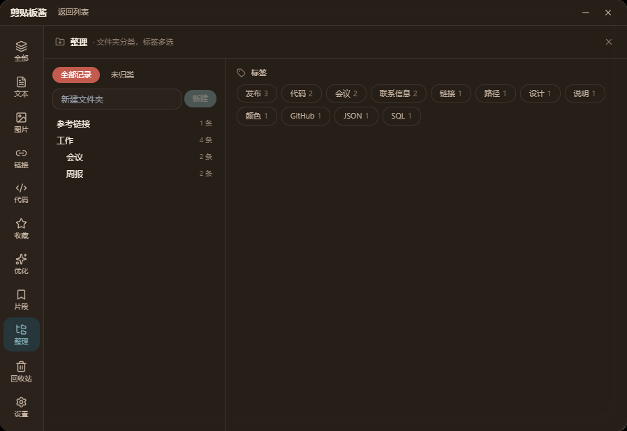<br><sub><b>智能整理</b>：文件夹树 + 标签云，点标签就是筛选</sub></td>
    <td width="50%">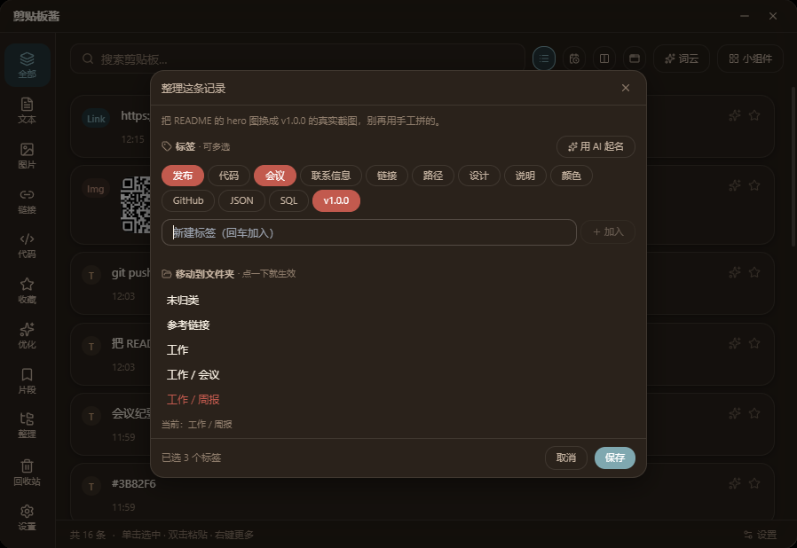<br><sub><b>整理一条记录</b>：标签是草稿，点保存才落库；「用 AI 起名」可选</sub></td>
  </tr>
  <tr>
    <td>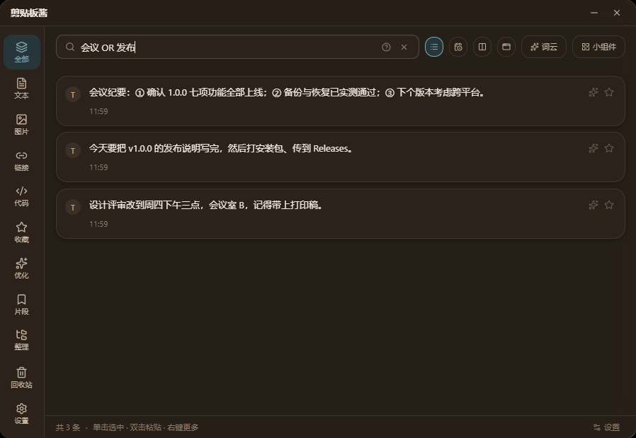<br><sub><b>搜索语法</b>：<code>会议 OR 发布</code>，右侧「?」是速查表</sub></td>
    <td>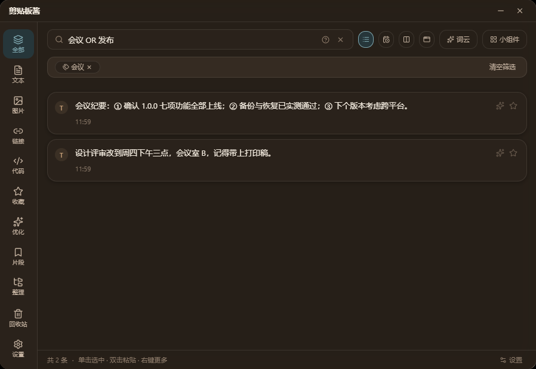<br><sub><b>标签筛选</b>：可与搜索、类型、时间范围叠加</sub></td>
  </tr>
  <tr>
    <td>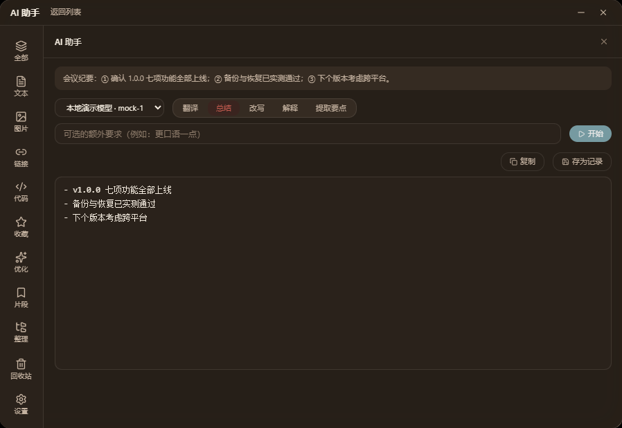<br><sub><b>AI 助手</b>：五个动作，走你自己的 Key</sub></td>
    <td>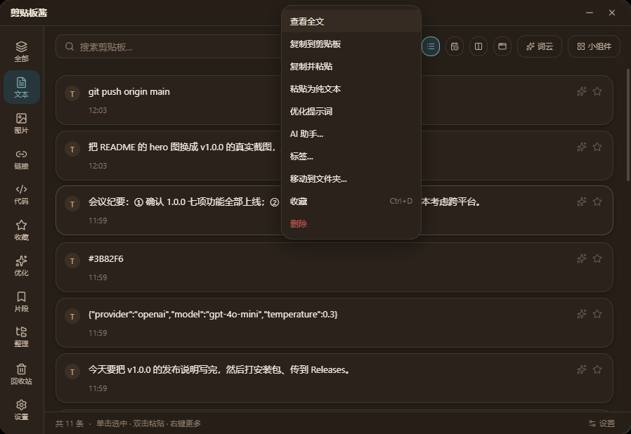<br><sub><b>右键菜单</b>：抠信息的、加工文本的、改属性的，分区摆放</sub></td>
  </tr>
  <tr>
    <td>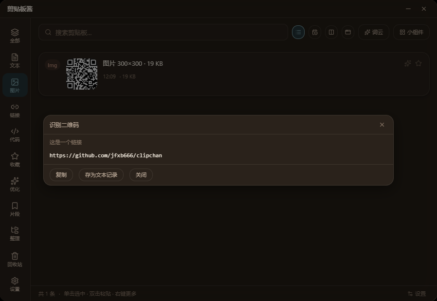<br><sub><b>二维码识别</b>：结果以 http(s) 开头会标「这是一个链接」</sub></td>
    <td>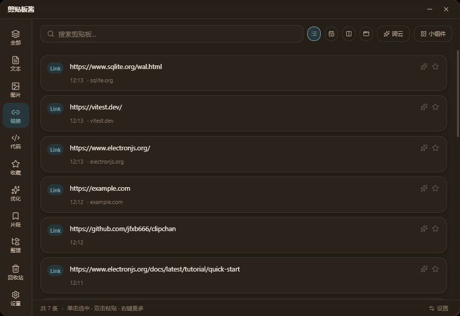<br><sub><b>链接预览</b>：卡片上的「· 域名」小标，悬停看标题</sub></td>
  </tr>
  <tr>
    <td>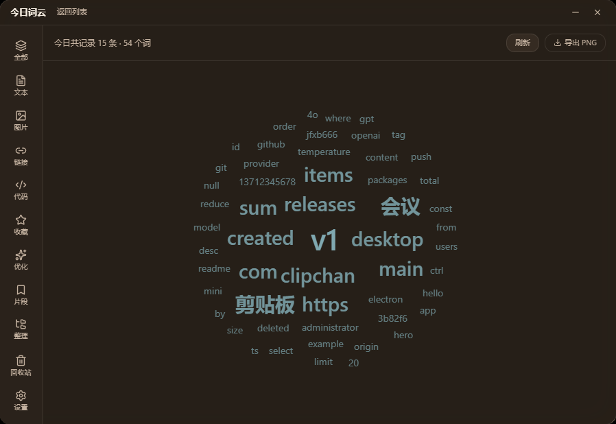<br><sub><b>今日词云</b>：今天都复制了些什么，可导出 PNG</sub></td>
    <td>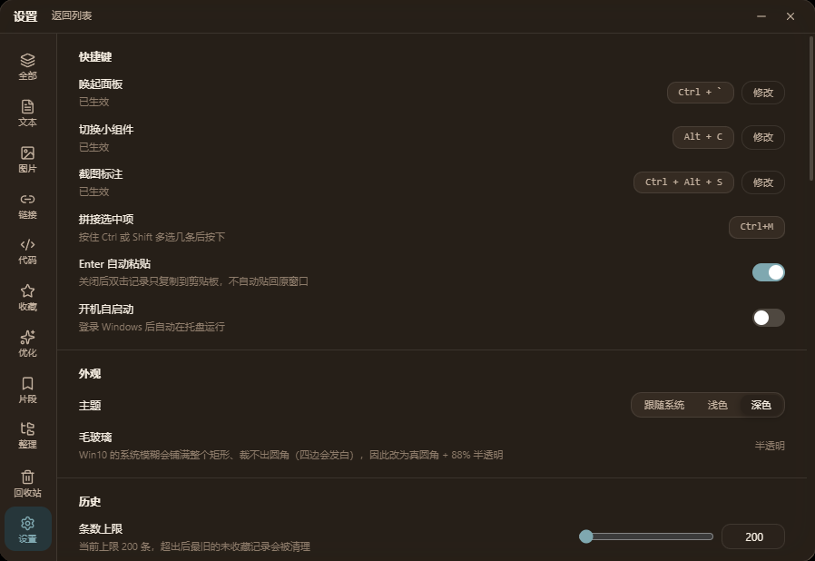<br><sub><b>设置</b>：快捷键、外观、历史上限、排除的应用</sub></td>
  </tr>
</table>

## 下载

到 [**Releases**](https://github.com/jfxb666/clipchan/releases/latest) 下载：

| 版本 | 文件 | 说明 |
| --- | --- | --- |
| **安装版（推荐）** | `Clipchan-Setup-1.0.0.exe` | 77 MB 安装包，装完占 291 MB 磁盘，**启动 0.3 秒级**，支持自动更新 |
| 免安装版 | `Clipchan.exe` | 单文件，双击即用。但它是个自解压包，**每次双击都要先把 291 MB 解到 `%TEMP%` 再启动**，本机实测 3.1 秒、慢机器上十几秒。只在不能安装的场合用 |

安装版装完托盘出现图标，按 <kbd>Ctrl</kbd>+<kbd>&#96;</kbd> 唤起面板。卸载走「设置 → 应用」或安装目录里的 `Uninstall Clipchan.exe`。

<details>
<summary>免安装版为什么慢（以及怎么清理残留）</summary>

免安装版是 NSIS 自解压包：每次启动都把整个程序目录解到 `%TEMP%\<25 位随机串>\`，退出后再删掉。正常退出会自己清理，但强杀进程、崩溃、断电时会留下一个约 290 MB 的目录。

清理用仓库里的脚本（默认只报告不删）：

```powershell
powershell -ExecutionPolicy Bypass -File scripts\clean-cache.ps1          # 预演
powershell -ExecutionPolicy Bypass -File scripts\clean-cache.ps1 -Apply   # 真删
```

它只认「临时目录里同时有 `Clipchan.exe` 与 `resources\app.asar`」这一个判据，不会误删别的程序。**`%APPDATA%\Clipchan\` 不要手删** —— 那是历史记录与设置。详见 [docs/cleanup-cache.md](docs/cleanup-cache.md)。

</details>

## 数据与隐私

**所有剪贴板数据只存在你自己的电脑上。** 没有账号、没有遥测、没有使用统计、没有崩溃上报、没有广告 SDK —— 什么都不收集。

一切落在 `%APPDATA%\Clipchan\`：`clipchan.db`（SQLite，WAL 模式）、`images\`、`thumbs\`、`backups\`、`ocr\`、`logs\`。退出应用后删掉整个目录就是彻底清除。

整个程序**只有四处**会联网，没有第五处：

| 场景 | 什么时候发 | 发什么 | 发给谁 |
| --- | --- | --- | --- |
| OCR 语言包 | 你在设置里点「下载语言包」 | 一个普通 GET，不带任何内容 | jsdelivr 公共 CDN，之后走本地缓存 |
| AI 优化 / AI 助手 / AI 起标签 | 你点了对应动作 | 你选中的那段文字 + 提示词 | **你自己填的 Base URL** |
| 链接预览 | 你复制了一个公网 `http(s)` 链接 | 一个普通 GET，不带 UA / Referer / 任何本地数据 | **那个链接自己的域名**，缓存 7 天 |
| 自动更新 | 你在设置里点「检查更新」 | 一个版本号请求 | GitHub Releases |

内网地址（`localhost` / `127.x` / `10.x` / `192.168.x` / `172.16–31.x` / `.local` / 纯 IPv6）**一个请求都不发**；站点图标只用链接自己主机的 `/favicon.ico`，刻意不用第三方图标服务。

已知边界：剪贴板历史**本身不加密**（能读 `%APPDATA%` 的程序就能读到你的历史；**AI Key 除外**，它经 Windows DPAPI 加密，只有当前 Windows 用户能解开）。建议一上手就把密码管理器、网银客户端加进「设置 → 排除的应用」—— 那是**复制那一刻就不入库**，不是事后隐藏。

完整说明见 [docs/privacy.md](docs/privacy.md)。

## 和别的剪贴板工具比

|  | Clipchan | 系统 <kbd>Win</kbd>+<kbd>V</kbd> | 跨平台工具（如 CopyQ / Ditto） |
| --- | --- | --- | --- |
| 中文拼音搜索 | 原文 / 全拼 / 首字母三路 | 无 | 多数只有原文 |
| 搜索语法 | 布尔 + 正则 + 时间范围 | 无 | 一般只有子串匹配 |
| 图片 | 缩略图 / 大图 / 感知哈希去重 / 二维码 | 只存不分类 | 视实现 |
| 富文本与文件 | Office 保真、文件真身回剪贴板 | 部分支持 | 视实现 |
| 整理 | 自动标签 + 三级文件夹 | 无 | 标签或分类，少有两样都有 |
| AI | 自带提示词优化 + 五种文本加工 | 无 | 无 |
| 数据位置 | 全部本地，零服务器 | 本地 | 本地 |

Clipchan **只做 Windows**。跨平台不在计划内 —— 原生剪贴板格式（`CF_HDROP` / `CF_HTML`）、毛玻璃、提权窗口兼容这些事，每个平台都是一套完全不同的坑，把三套都做对不如把一套做透。

## 技术栈

```
Electron 37 + React 18 + TypeScript 5.9 + Vite 6 + Tailwind
better-sqlite3 (WAL)  ·  zustand  ·  framer-motion  ·  lucide-react
tesseract.js 7 (OCR, WASM)  ·  jsqr (二维码)  ·  pinyin-pro (拼音索引)
C# 原生助手（CF_HDROP / DWM 毛玻璃）
```

- **单进程优先**：能放渲染层的都放渲染层，只有碰系统能力（剪贴板原生格式、DWM、tesseract）才下主进程。
- **零服务器**：没有后端、没有数据库服务、没有对象存储。更新走 GitHub Releases，AI 走用户自己的 Key。
- **诚实降级**：助手进程不可用、系统加密不可用、模型没按格式返回、目标窗口失效 —— 每一种都如实告诉用户发生了什么，绝不假装成功。
- **测试 1670 条**：`packages/**/*.spec.ts`，覆盖算法、状态机、数据库迁移、IPC 契约、更新状态映射。

## 开发

```bash
pnpm install      # pnpm 11 的构建脚本许可写在 pnpm-workspace.yaml 的 allowBuilds 里
pnpm dev          # 开发模式（Vite + Electron 热重载）
pnpm typecheck    # tsc -b
pnpm test         # vitest run：85 个文件 / 1670 个用例
pnpm build:helper # 编译 C# 原生助手 → packages/desktop/helper/dist/clipchan-helper.exe
pnpm smoke:main   # 主进程冒烟（13 项断言，跑前先退出已在运行的 Clipchan）
pnpm build        # 打包 → release/Clipchan.exe 与 release/Clipchan-Setup-<版本>.exe
```

目录结构：

| 路径 | 内容 |
| --- | --- |
| `packages/core` | 平台无关：类型、分类/去重/拼接/词云算法、状态管理、React 界面 |
| `packages/ai` | 平台无关的 AI 层：三协议适配器、场景方法论、提示词优化、AI 助手（零依赖，只用 Web 标准 API） |
| `packages/desktop` | Electron 主进程、C# 原生助手、渲染层入口 |
| `packages/mobile` | Capacitor 壳（**只搭壳**，无 APK、无持久化，见下文） |
| `legacy` | 旧版 C# WinForms 源码留档，不参与构建 |

## 能力边界（如实写）

- **手机端这一轮只搭壳。** 能构建出在 Capacitor WebView 里跑的 Web 包，但没有 APK（本机没装 JDK / Android SDK），也没有持久化。Android 10 起后台读剪贴板被系统禁止，产品形态只能是「手动粘进来 + 手动复制出去」。
- **Win10 的毛玻璃是窗口内模糊**，不是系统级 acrylic；助手不可用时降级为半透明 + 内部阴影，设置页会显示「已降级」。
- **自动粘贴在提权窗口会失效**（UIPI 是系统限制），此时回退为「已复制，按 Ctrl+V 粘贴」，不静默失败。
- **AI 质量取决于你选的模型**，程序只负责把方法论和原文拼成一次请求，不联网取规则。
- **图片相似去重只提示不拦截**：连着复制两次同一张图是常事，悄悄丢掉才是数据丢失。
- **搜索语法在应用层求值**，候选行上限 20000 —— 单库几十万条时，极复杂表达式会比纯关键词慢一点。
- **AI 助手面板的「停止」按钮这一版是禁用的**，运行中只能等它跑完。

更细的行为说明（每个功能的具体规则、为什么这么实现）都在 **[docs/guide.md](docs/guide.md)** 里。

## 出问题时

主进程日志在 `%APPDATA%\Clipchan\logs\main.log`（2 MB 轮转，留 5 份）。设置 → 关于 →「打开数据目录」可直达。崩溃只记录、不退出 —— 看到 `[crash]` 行不代表进程当时死了。日志只写本机，不会自动上传。

数据库坏了不会白屏：启动时先跑 `PRAGMA quick_check`，判定损坏就从 `backups\` 里最新的、通过检查的备份自动恢复；一个可用备份都没有时才把原库改名成 `clipchan.corrupt-<时间戳>.db` 并新建空库。两种情况都会弹一条提示说明发生了什么。

## 更新日志

- **v1.0.0**（当前）— AI 助手、搜索语法、智能整理、链接预览、图片去重、二维码识别、Key 加密、自动备份、包体瘦身 10.6 MB。[完整说明](docs/release-notes-1.0.0.md)
- 更早的版本见 [Releases](https://github.com/jfxb666/clipchan/releases) 与 [docs/](docs/)。

## License

MIT © 2026 [jfxb666](https://github.com/jfxb666)。见 [LICENSE](LICENSE)。
